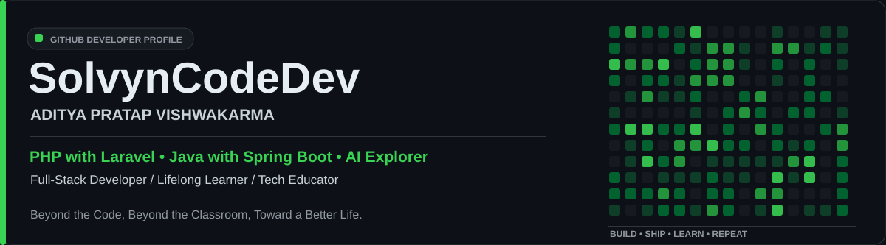
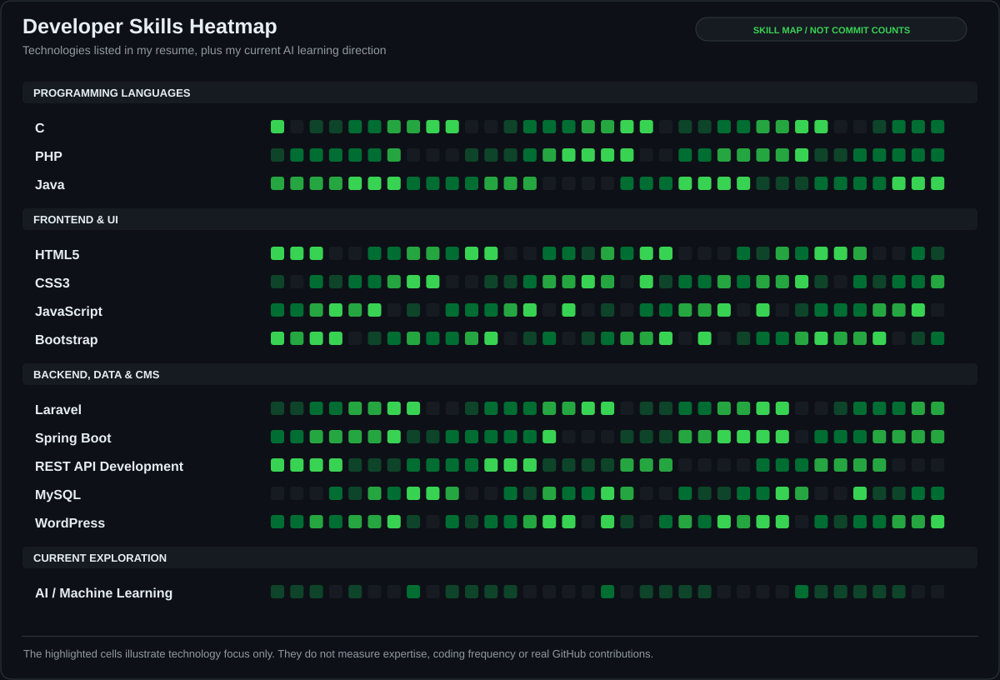
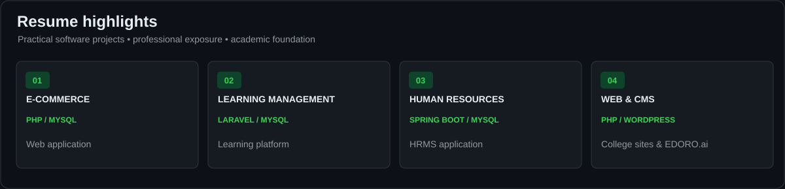
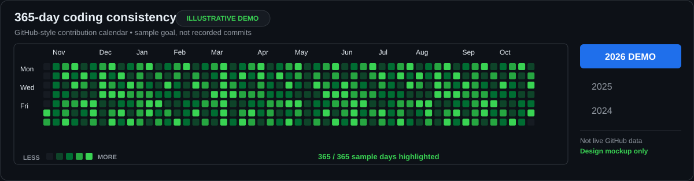

  

   

  
  
  

    

  

---

## 👨‍💻 About Me

Hi! I'm **Aditya Pratap Vishwakarma**, a **Computer Science & Engineering student** and an **aspiring full-stack developer**. I enjoy building real-world websites, database-driven applications and REST APIs, while exploring how **AI and machine learning** can improve software products.

- 🎓 Pursuing a **B.Tech in Computer Science & Engineering** at **B. N. College of Engineering and Technology, Lucknow (AKTU)** — third year, lateral entry.
- ⚙️ Core focus: **PHP with Laravel** and **Java with Spring Boot**.
- 🧩 Experience with frontend development, backend logic, API integration, MySQL and WordPress.
- 🏢 **One year at Softpro India Pvt. Ltd.**, contributing to assigned team tasks and building professional development skills.
- 🤖 **AI Explorer:** learning AI/ML concepts and experimenting with intelligent applications. *(Learning focus, not a claimed AI/ML professional specialization.)*
- 🎬 Sharing development and technology learning under **SolvynCodeDev**. Learning content is delivered in **English and Hinglish**.

> **Beyond the Code, Beyond the Classroom, Toward a Better Life.**

## 🧰 Technical Stack

**Programming Languages**

**Frontend Development**

**Backend Frameworks**

**Database, CMS & Tools**

| Area | Skills and experience |
| :--- | :--- |
| **Programming** | C, PHP, Java |
| **Frontend** | HTML5, CSS3, JavaScript, Bootstrap |
| **Backend** | PHP with Laravel, Java with Spring Boot, REST API development |
| **Database & CMS** | MySQL, WordPress |
| **Currently exploring** | AI/ML fundamentals and AI-powered application development |

### 🟩 Skills Heatmap — Resume-Based Visual

  

**Design illustration:** The squares are a visual representation of my technology interests and resume skills. They are not actual GitHub language contributions, proficiency percentages or daily coding streaks.

## 💻 Projects & Practical Work

  

| Project | Technology | Description |
| :--- | :--- | :--- |
| **E-Commerce Website** | PHP, MySQL | E-commerce web application with database-backed features. |
| **Learning Management System (LMS)** | PHP with Laravel, MySQL | Learning management platform developed using Laravel. |
| **Human Resource Management System (HRMS)** | Java with Spring Boot, MySQL | HRMS application built with Spring Boot and MySQL. |
| **College Websites & EDORO.ai Website** | PHP, WordPress | Website development and CMS-related work. |

> These are projects named on my resume. They are not all necessarily available as public GitHub repositories.

🔎 **[Explore my public repositories](https://github.com/AdityaGit8009?tab=repositories)**

## 🏢 Professional Experience

**Softpro India Pvt. Ltd.** — *Professional experience, 1 year*

- Collaborated with a team on assigned development-related tasks.
- Gained practical experience in a professional work environment.
- Continued developing technical skills, problem-solving and communication.

## 🎓 Education

| Qualification | Institute | Academic detail |
| :--- | :--- | :--- |
| **B.Tech — Computer Science & Engineering** | B. N. College of Engineering and Technology, Lucknow (AKTU) | Pursuing third year (lateral entry); 70.2% in second year |
| **Diploma — Computer Science & Engineering** | CSJM Government Polytechnic, Ambedkarnagar (UPBTE) | 76.83% |
| **Class 12** | JRVBSIC, Nawsanda (UP Board) | 69.4% |
| **Class 10** | JRVBSIC, Nawsanda (UP Board) | 73.17% |

## 📊 GitHub Activity — Live Statistics

  
  

### 🔥 Real Contribution Streak

  

Real GitHub statistics above are served by third-party services and may be cached, delayed or temporarily unavailable. The live **Top Languages** card reports languages detected in public GitHub repositories, which is different from the complete skills list in my resume.

## 🗓️ 365-Day Coding Consistency — GitHub-Style Demo

  

**Important:** This fully green calendar is a **visual example of a 365-day consistency challenge**, not my actual contribution record. The real activity chart remains available on my [GitHub profile](https://github.com/AdityaGit8009). README images do not change GitHub's contribution history.

## 🎯 Areas I'm Focused On

- **Backend engineering:** PHP/Laravel, Java/Spring Boot and REST APIs.
- **Database-backed applications:** MySQL integration, data models and reliable application workflows.
- **Frontend engineering:** accessible, responsive experiences with HTML, CSS, JavaScript and Bootstrap.
- **AI exploration:** machine learning fundamentals and integration ideas for useful AI-enabled software.
- **Continuous learning:** practical projects, stronger fundamentals and collaborative development.

## 🎥 SolvynCodeDev — Learn, Build, Share

**SolvynCodeDev** is my developer learning and content identity, focused on software engineering and practical programming education.

**Content pillars:** PHP & Laravel · Java & Spring Boot · Frontend · SQL & Databases · Projects · AI exploration.

**Teaching language:** English and Hinglish. **Written guides and descriptions:** English.

## 🌱 Professional Strengths

- Fast learner with a problem-solving mindset.
- Clear communication and collaborative working style.
- Positive attitude and willingness to grow through hands-on work.

## 🤝 Connect With Me

  
  
  
  

---

**Learn consistently. Build thoughtfully. Share what matters.**

Aditya Pratap Vishwakarma · SolvynCodeDev · GitHub: <a href="https://github.com/AdityaGit8009">@AdityaGit8009</a>

