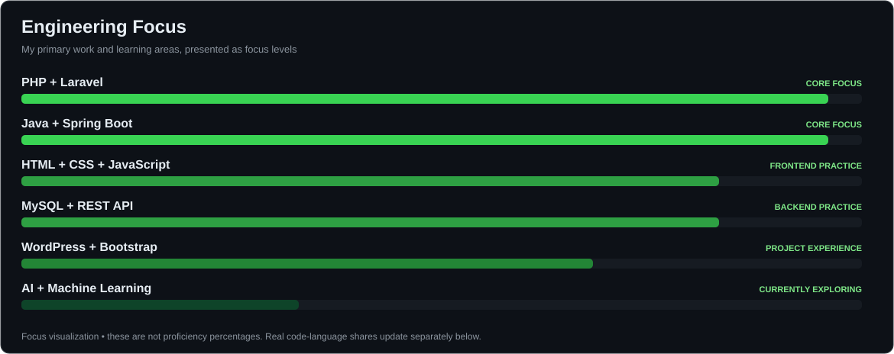
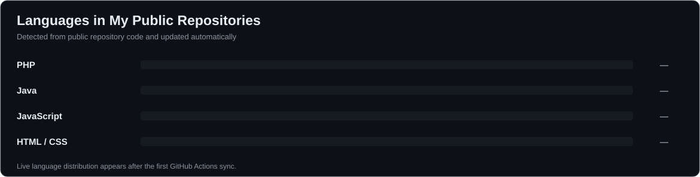
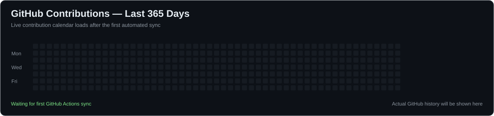

 

  

---

## 👋 About Me

Hello! I'm **Aditya Pratap Vishwakarma**, a **Computer Science and Engineering student** and aspiring **full-stack software developer** with practical exposure to frontend applications, backend services, database-backed systems and content management websites.

- 🎓 Pursuing **B.Tech in Computer Science & Engineering** at **B. N. College of Engineering and Technology, Lucknow (AKTU)** — third year, lateral entry.
- 💻 Main development areas: **PHP with Laravel** and **Java with Spring Boot**, alongside frontend and SQL.
- 🏢 **One year of professional experience at Softpro India Pvt. Ltd.** supporting team-based work and improving technical skills.
- 🌱 Currently exploring **AI/ML fundamentals**, intelligent applications and practical software engineering.
- 🧠 I value hands-on development, clear communication, continuous learning and problem-solving.

> **Beyond the Code, Beyond the Classroom, Toward a Better Life.**

## 🛠️ Languages, Frameworks & Tools

**Languages**

**Frontend**

**Backend**

**Database, CMS & Development Tools**

| Domain | Technologies |
| :--- | :--- |
| **Programming languages** | C, PHP, Java |
| **Frontend development** | HTML5, CSS3, JavaScript, Bootstrap |
| **Backend engineering** | PHP with Laravel, Java with Spring Boot, REST API development |
| **Database and CMS** | MySQL, WordPress |
| **Current exploration** | AI and machine learning fundamentals |

### 📈 Engineering Focus — Progress Bars

### 📊 My Public Code — Live Language Distribution

*Language percentages are calculated from GitHub's language-byte data across up to 50 recently updated non-fork public repositories, not from self-rated proficiency.*

## 💻 Projects & Practical Work

My resume includes practical work on the following applications:

| Project / Work | Technology | Focus |
| :--- | :--- | :--- |
| **E-Commerce Website** | PHP, MySQL | Database-backed shopping website |
| **Learning Management System (LMS)** | PHP with Laravel, MySQL | Course and learning platform |
| **Human Resource Management System (HRMS)** | Java with Spring Boot, MySQL | Workforce and HR operations |
| **College Websites & EDORO.ai** | PHP, WordPress | Websites, CMS and content development |

### 🔗 My Public GitHub Repositories — Automatically Updated

Only **public, non-fork repositories** are linked here. The list is refreshed directly from GitHub; resume projects are not falsely matched to a repository with a different name.

<!-- PUBLIC_REPOS_START -->
| Repository | Description | Primary language |
| :--- | :--- | :--- |
| [innov-ecom](https://github.com/AdityaGit8009/innov-ecom) | Open-source project repository | PHP |
| [lms-laravel](https://github.com/AdityaGit8009/lms-laravel) | Open-source project repository | Blade |
| [lms](https://github.com/AdityaGit8009/lms) | Learning Management System | PHP |
| [OJP](https://github.com/AdityaGit8009/OJP) | Online Job Portal | HTML |
| [FTS](https://github.com/AdityaGit8009/FTS) | Open-source project repository | JavaScript |
| [SMS](https://github.com/AdityaGit8009/SMS) | Student Management System | PHP |
| [SecondGitRepo](https://github.com/AdityaGit8009/SecondGitRepo) | Open-source project repository | HTML |
| [GitSecondRepo](https://github.com/AdityaGit8009/GitSecondRepo) | This is Second Git Repository | — |
| [ApnaCollege-Project](https://github.com/AdityaGit8009/ApnaCollege-Project) | This is my Repository | HTML |
| [Portfolio](https://github.com/AdityaGit8009/Portfolio) | This is my portfolio website | HTML |

[Browse all my public repositories](https://github.com/AdityaGit8009?tab=repositories)
<!-- PUBLIC_REPOS_END -->

## 🏢 Experience

**Softpro India Pvt. Ltd. — 1 year**

- Worked with a team on assigned tasks in a professional development environment.
- Practiced technical communication, collaboration and problem-solving.
- Strengthened frontend, backend and practical application development experience.

## 🎓 Education

| Qualification | Institute | Result / Status |
| :--- | :--- | :--- |
| **B.Tech, CSE** | B. N. College of Engineering and Technology, Lucknow (AKTU) | 3rd year (lateral entry); 70.2% in second year |
| **Diploma, CSE** | CSJM Government Polytechnic, Ambedkarnagar (UPBTE) | 76.83% |
| **Class XII** | JRVBSIC, Nawsanda (UP Board) | 69.4% |
| **Class X** | JRVBSIC, Nawsanda (UP Board) | 73.17% |

## 🟩 GitHub Contribution Calendar — Last 365 Days

The calendar is generated using **my recorded GitHub contribution history**. Dates without contributions remain unfilled; updates run automatically through GitHub Actions. [Open the native GitHub contributions view](https://github.com/AdityaGit8009).

## 🔥 GitHub Streak & Activity

  

*Third-party activity widgets may be delayed or temporarily unavailable. The contribution calendar above is rebuilt directly from GitHub's API.*

## 🚀 What I'm Working Toward

- Designing better **backend APIs** using Laravel and Spring Boot.
- Building responsive, maintainable **frontend experiences**.
- Improving practical database design, integration and application architecture.
- Exploring **AI-powered applications** while strengthening foundational software engineering skills.
- Publishing useful projects, growing through feedback and contributing to public repositories.

## 🤝 Let's Connect

  

**Learn • Build • Improve • Share**

© Aditya Pratap Vishwakarma — GitHub @AdityaGit8009

