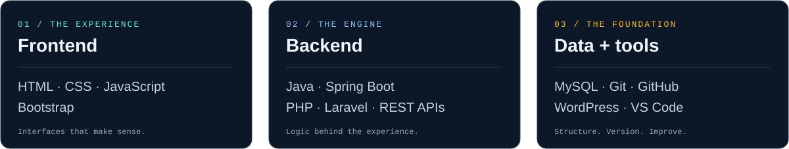
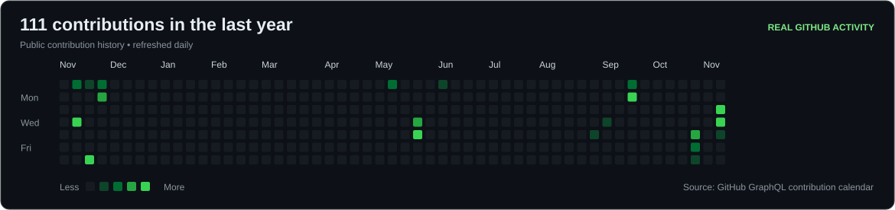
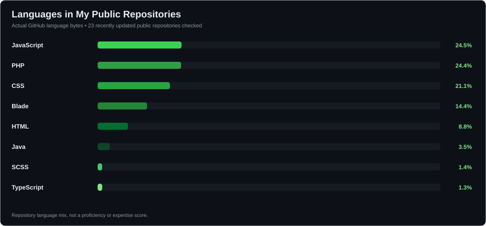

  

  

**[About](#01--behind-the-code) · [Projects](#02--selected-builds) · [Stack](#03--my-toolbox) · [Activity](#04--the-work-in-progress)**

## 01 / Behind the code

I'm **Aditya Pratap Vishwakarma**, a CSE student building web applications with **Java / Spring Boot** and **PHP / Laravel**. I enjoy connecting the pieces: a useful interface, a clear API, and a database that makes sense.

My work spans business applications, learning platforms and content-driven websites. I'm sharpening my backend engineering skills and exploring where **AI/ML** can make everyday software more useful.

| Building with | Learning toward | Experience |
| :--- | :--- | :--- |
| Spring Boot · Laravel · MySQL | Better APIs, application architecture and AI fundamentals | One year at **Softpro India Pvt. Ltd.** |

> Beyond the code. Beyond the classroom. Always something new to build.

## 02 / Selected builds

<table>
<tr>
<td width="50%" valign="top">
<h3>01 &nbsp; EnterpriseOS</h3>

A multi-tenant business operations platform, connecting business workflows through a full-stack application.

<code>Java 25</code> <code>Spring Boot</code> <code>React</code> <code>TypeScript</code> <code>MySQL</code>

<a href="https://github.com/AdityaGit8009/EnterpriseOS"><b>Explore the repository →</b></a>

</td>
<td width="50%" valign="top">
<h3>02 &nbsp; Learning Management</h3>

Learning-platform development with Laravel, alongside a PHP learning management system.

<code>PHP</code> <code>Laravel</code> <code>Blade</code>

<a href="https://github.com/AdityaGit8009/lms-laravel"><b>Laravel project →</b></a> &nbsp; <a href="https://github.com/AdityaGit8009/lms">PHP project →</a>

</td>
</tr>
<tr>
<td width="50%" valign="top">
<h3>03 &nbsp; Student Management</h3>

A student management system exploring practical administration through a PHP application.

<code>PHP</code> <code>Web application</code>

<a href="https://github.com/AdityaGit8009/SMS"><b>Explore the repository →</b></a>

</td>
<td width="50%" valign="top">
<h3>04 &nbsp; Frontend Workshop</h3>

Small builds for practicing interfaces and interaction: a calculator, temperature converter and browser game.

<code>HTML</code> <code>CSS</code> <code>JavaScript</code>

<a href="https://github.com/AdityaGit8009/Calculator">Calculator →</a> &nbsp; <a href="https://github.com/AdityaGit8009/Tempererature-Converter">Converter →</a> &nbsp; <a href="https://github.com/AdityaGit8009/Tic-Tac-Toe">Tic-tac-toe →</a>

</td>
</tr>
</table>

<b>Explore more public repositories</b> · updated automatically

 

<!-- PUBLIC_REPOS_START -->
| Repository | Description | Primary language |
| :--- | :--- | :--- |
| [Tempererature-Converter](https://github.com/AdityaGit8009/Tempererature-Converter) | Explore the source and project files | JavaScript |
| [EnterpriseOS](https://github.com/AdityaGit8009/EnterpriseOS) | Multi-tenant business operations platform built with Java 25, Spring Boot, React, TypeScript, a… | HTML |
| [Calculator](https://github.com/AdityaGit8009/Calculator) | Explore the source and project files | CSS |
| [SMS](https://github.com/AdityaGit8009/SMS) | Student Management System | PHP |
| [innov-ecom](https://github.com/AdityaGit8009/innov-ecom) | Explore the source and project files | PHP |
| [lms-laravel](https://github.com/AdityaGit8009/lms-laravel) | Explore the source and project files | Blade |
| [lms](https://github.com/AdityaGit8009/lms) | Learning Management System | PHP |
| [OJP](https://github.com/AdityaGit8009/OJP) | Online Job Portal | HTML |
| [FTS](https://github.com/AdityaGit8009/FTS) | Explore the source and project files | JavaScript |
| [SecondGitRepo](https://github.com/AdityaGit8009/SecondGitRepo) | Explore the source and project files | HTML |

[Browse all my public repositories](https://github.com/AdityaGit8009?tab=repositories)
<!-- PUBLIC_REPOS_END -->

## 03 / My toolbox

**Also in my toolkit:** C programming. **Currently exploring:** AI/ML fundamentals and intelligent applications.

<b>The path so far</b> · experience, education and practical work

### Experience

**Softpro India Pvt. Ltd. · One year**

Worked in a team development environment, building practical frontend and backend skills alongside technical communication and problem-solving.

### Education

- **B.Tech, Computer Science & Engineering** — B. N. College of Engineering and Technology, Lucknow (AKTU); lateral entry.
- **Diploma, Computer Science & Engineering** — CSJM Government Polytechnic, Ambedkarnagar (UPBTE).

### Other practical work

E-commerce development with PHP and MySQL; HR management with Java and Spring Boot; college websites and content development using PHP and WordPress, including work on EDORO.ai.

## 04 / The work in progress

**Current direction:** stronger backend APIs, clearer database design, responsive interfaces and practical AI exploration.

Charts refresh daily from GitHub's API. Language share measures code bytes across up to 50 recent public repositories, rather than proficiency. <a href="https://github.com/AdityaGit8009?tab=repositories">Browse the code →</a>

  

---

### Have something useful in mind? Let's build it.

Happy to connect over **Java, Laravel, web applications and learning together**.

**[Portfolio](https://aditya-portfolio.duckdns.org) &nbsp; / &nbsp; [LinkedIn](https://www.linkedin.com/in/vish-aditya/) &nbsp; / &nbsp; [Email](mailto:adityapratap05072005@gmail.com)**

 

