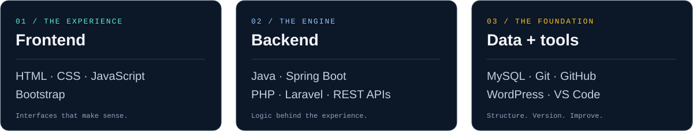
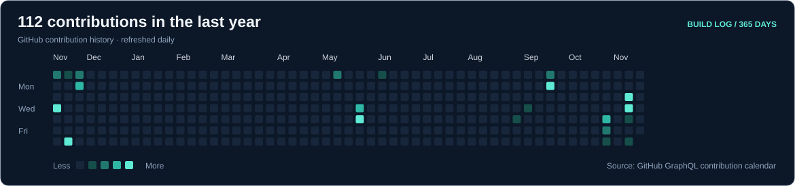
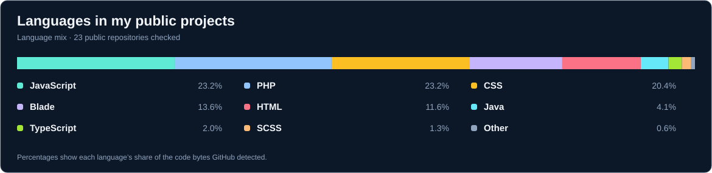

<h1 align="center"></h1>

  <a href="https://adityagit8009.github.io/Portfolio/"><b>Portfolio</b></a> ·
  <a href="https://github.com/AdityaGit8009/EnterpriseOS"><b>Explore EnterpriseOS</b></a> ·
  <a href="https://adityagit8009.github.io/Calculator/">Try the calculator</a> ·
  <a href="https://www.linkedin.com/in/vish-aditya/">LinkedIn</a> ·
  <a href="mailto:adityapratap05072005@gmail.com">Email</a>

I'm **Aditya**, a Computer Science & Engineering student in Lucknow. I build web applications with **Java and Spring Boot** and **PHP and Laravel**. I enjoy following a feature from the screen through its API to the records it writes in MySQL.

[Selected projects](#selected-projects) · [Recent work](#recent-work) · [Stack and background](#stack-and-background) · [GitHub activity](#github-activity)

## Selected projects

### EnterpriseOS

A multi-tenant business operations platform for teams managing people, inventory and finance. The React and TypeScript client calls a Java 25 / Spring Boot API backed by MySQL. To see how the application fits together, start with the client and API side by side.

[Repository](https://github.com/AdityaGit8009/EnterpriseOS) · [React client](https://github.com/AdityaGit8009/EnterpriseOS/tree/main/apps/web) · [Java API](https://github.com/AdityaGit8009/EnterpriseOS/tree/main/services/api) · 

### Education software

| Project | What to explore |
| --- | --- |
| [Learning Management](https://github.com/AdityaGit8009/lms-laravel) | Laravel routes and Blade views for attendance, assessments and learning content. [Related LMS repository](https://github.com/AdityaGit8009/lms) |
| [Student Management](https://github.com/AdityaGit8009/SMS) | A PHP and Laravel application for student records, fees and examinations. |

### In the browser

| Project | Try it |
| --- | --- |
| [Calculator](https://github.com/AdityaGit8009/Calculator) | Type `2 + 3 * 4` to see the keypad's operator precedence in action. [Open calculator](https://adityagit8009.github.io/Calculator/) |
| [Temperature converter](https://github.com/AdityaGit8009/Tempererature-Converter) | Enter a value in Celsius, Fahrenheit or Kelvin to update the other two fields. [Open converter](https://adityagit8009.github.io/Tempererature-Converter/TemperatureConverterPro/) |
| [Tic-tac-toe](https://github.com/AdityaGit8009/Tic-Tac-Toe) | Two players share a board. The [round logic](https://github.com/AdityaGit8009/Tic-Tac-Toe/blob/main/Tic%20Tac%20Toe/script.js) handles wins, draws and resetting the game. |

## Recent work

The latest commit on each of my five most recently updated default branches. Each entry links to its diff.

<!-- RECENT_WORK_START -->
| Date (UTC) | Project | Latest default-branch commit |
| --- | --- | --- |
| 2026-11-21 | [JQuery-Task](https://github.com/AdityaGit8009/JQuery-Task) | [Exercise form validation, media state and keyboard behavior in Chromium](https://github.com/AdityaGit8009/JQuery-Task/commit/dc235f9ea7bec4784ed1dd2a887e36226912766a) |
| 2026-11-21 | [JS-Task](https://github.com/AdityaGit8009/JS-Task) | [Document the live directory, local setup, and twenty exercise prompts](https://github.com/AdityaGit8009/JS-Task/commit/475452433dafccedcd8782c818ce640c69770b69) |
| 2026-11-21 | [lms-laravel](https://github.com/AdityaGit8009/lms-laravel) | [Exclude installation-specific cached configuration from the bundled s…](https://github.com/AdityaGit8009/lms-laravel/commit/a625977496cd0e2c8bb448902ca3c6975ee61e8e) |
| 2026-11-21 | [lms](https://github.com/AdityaGit8009/lms) | [Exercise the real guest redirect in the application entry test](https://github.com/AdityaGit8009/lms/commit/bd6afd683793d315658d34579cfeb2206788b12e) |
| 2026-11-21 | [Web-BNMC](https://github.com/AdityaGit8009/Web-BNMC) | [Run the college navigation checks for pushes and pull requests](https://github.com/AdityaGit8009/Web-BNMC/commit/01c6fc955b03f78bdc9d6a1328e68afd83ce6f4a) |
<!-- RECENT_WORK_END -->

<b>Public project index</b>

The ten most recently pushed repositories I own, excluding forks, archives and this profile.

<!-- PUBLIC_REPOS_START -->
| Repository | Primary language | Last push (UTC) |
| --- | --- | --- |
| [JQuery-Task](https://github.com/AdityaGit8009/JQuery-Task) | HTML | 2026-11-21 |
| [JS-Task](https://github.com/AdityaGit8009/JS-Task) | HTML | 2026-11-21 |
| [lms](https://github.com/AdityaGit8009/lms) | PHP | 2026-11-21 |
| [lms-laravel](https://github.com/AdityaGit8009/lms-laravel) | Blade | 2026-11-21 |
| [TajHotel](https://github.com/AdityaGit8009/TajHotel) | HTML | 2026-11-21 |
| [Web-BNMC](https://github.com/AdityaGit8009/Web-BNMC) | HTML | 2026-11-21 |
| [ApnaCollege-Project](https://github.com/AdityaGit8009/ApnaCollege-Project) | HTML | 2026-11-21 |
| [OJP](https://github.com/AdityaGit8009/OJP) | HTML | 2026-11-21 |
| [GitSecondRepo](https://github.com/AdityaGit8009/GitSecondRepo) | — | 2026-11-21 |
| [Youtube-Frontend](https://github.com/AdityaGit8009/Youtube-Frontend) | HTML | 2026-11-21 |
<!-- PUBLIC_REPOS_END -->

[Browse all public repositories](https://github.com/AdityaGit8009?tab=repositories)

## Stack and background

I also work with C. Right now I'm focusing on API design, relational data modeling and the fundamentals of AI and machine learning.

<b>Experience and education</b>

- **Softpro India Pvt. Ltd.** One year working with a development team on practical frontend and backend skills, technical communication and problem-solving.
- **B.Tech in Computer Science & Engineering** at B. N. College of Engineering and Technology, Lucknow (AKTU), through lateral entry.
- **Diploma in Computer Science & Engineering** from CSJM Government Polytechnic, Ambedkarnagar (UPBTE).

My other work includes PHP and MySQL e-commerce development, HR management with Java and Spring Boot, and PHP and WordPress work on college websites and EDORO.ai.

[Personal portfolio](https://adityagit8009.github.io/Portfolio/) · [Portfolio source](https://github.com/AdityaGit8009/Portfolio)

## GitHub activity

<b>How this profile updates</b>

The [refresh workflow](./.github/workflows/update-profile.yml) is scheduled daily at **03:17 UTC**. It reads public project metadata and default-branch commits. The calendar uses the day counts visible on my [signed-out GitHub profile](https://github.com/users/AdityaGit8009/contributions). When projects publish stable releases, up to three appear below the commit table. The language chart adds up the code bytes GitHub reports across up to 50 of my most recently pushed public, non-fork, unarchived projects.

The [profile checks](./.github/workflows/validate-profile.yml) exercise the generator with fixtures and check the README's local links, section anchors and SVGs on pull requests. Dependabot checks the pinned GitHub Actions monthly.

 

